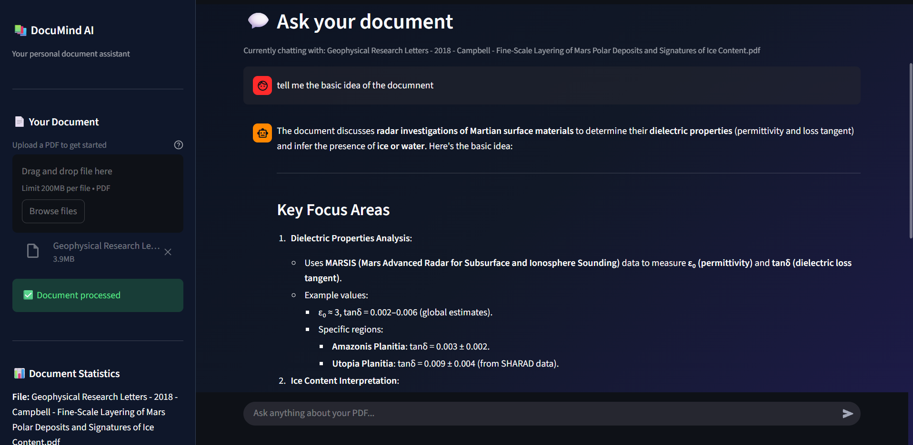

# 📚 DocuMind AI — Chat with Your PDFs (100% Free & Local)

DocuMind AI is a **Retrieval-Augmented Generation (RAG)** chatbot. You upload a PDF, ask questions in plain English, and get answers that are grounded in the content of *your* document.

Everything runs **locally on your own machine**: the embeddings, the vector database and the language model. There are **no API keys, no paid credits and no data leaving your computer**.

> Built with Streamlit · LangChain · Hugging Face Sentence-Transformers · FAISS · Ollama (Qwen3 8B) · pdfplumber

---

## 📑 Table of Contents

1. [Features](#-features)
2. [Demo / Screenshots](#-demo--screenshots)
3. [How It Works (Architecture)](#-how-it-works-architecture)
4. [Tech Stack and Why Each Choice Was Made](#-tech-stack-and-why-each-choice-was-made)
5. [Why Not OpenAI?](#-why-not-openai)
6. [Project Structure](#-project-structure)
7. [Installation](#-installation)
8. [Running the App](#-running-the-app)
9. [Code Walkthrough](#-code-walkthrough)
10. [Configuration and Tuning](#-configuration-and-tuning)
11. [Known Limitations](#-known-limitations)
12. [Troubleshooting](#-troubleshooting)
13. [Future Improvements](#-future-improvements)
14. [License](#-license)

---

## ✨ Features

- 📄 **PDF upload and text extraction** with page tracking
- ✂️ **Smart chunking** that keeps paragraphs and sentences intact where possible
- 🔎 **Semantic search** (finds passages by *meaning*, not just matching keywords)
- 🤖 **Local LLM answers** via Ollama, with no internet needed after setup
- 📚 **"View retrieved context" panel** so you can see exactly which passages the answer was based on (transparency + easy fact-checking)
- 🛡️ **Grounded answers**: the prompt forces the model to answer only from the document and to admit when the information isn't there
- ♻️ **File hashing (SHA-256)** so the same PDF is never processed twice
- 🎨 **Custom dark UI** built with Streamlit and CSS
- 💸 **Completely free**: no API costs

---

## 🖼️ Demo / Screenshots




---

## 🧠 How It Works (Architecture)

This project follows the classic RAG pipeline. There are two phases: **indexing** (once per PDF) and **querying** (once per question).

```
                    ┌──────────────── INDEXING (once per PDF) ────────────────┐
                    │                                                          │
   PDF upload ───►  pdfplumber ───► Text splitter ───► Embedding model ───► FAISS index
                  (extract text    (1000-char chunks,  (all-MiniLM-L6-v2,   (stored in
                   page by page)    200 overlap)        384-dim vectors)     memory)
                    │                                                          │
                    └──────────────────────────────────────────────────────────┘

                    ┌──────────────── QUERYING (every question) ──────────────┐
                    │                                                          │
   Question ───►  Embed question ───► FAISS top-4 similarity ───► Prompt + context ───► Qwen3 8B (Ollama) ───► Answer
                  (same MiniLM        search                       (system rules +                          + shown sources
                   model)                                           retrieved chunks)
                    │                                                          │
                    └──────────────────────────────────────────────────────────┘
```

### Step by step

1. **Upload**: the user uploads a PDF in the sidebar.
2. **Hashing**: a SHA-256 hash of the file is computed. If it matches the previously processed file, processing is skipped.
3. **Extraction**: `pdfplumber` reads each page and extracts its text. Each page is prefixed with a marker such as `[Page 3]` so the model can cite page numbers.
4. **Chunking**: the full text is split into overlapping chunks of about 1000 characters.
5. **Embedding**: each chunk is converted into a 384-dimensional vector by the `all-MiniLM-L6-v2` model.
6. **Indexing**: the vectors are stored in a FAISS index (kept in memory / Streamlit session state).
7. **Question**: when the user asks something, the question is embedded with the same model.
8. **Retrieval**: FAISS returns the 4 chunks whose vectors are closest to the question's vector.
9. **Generation**: those chunks are placed inside a prompt as "context" and sent to the local `qwen3:8b` model through Ollama.
10. **Display**: the answer is shown, with an expandable panel containing the retrieved chunks.

---

## 🛠️ Tech Stack and Why Each Choice Was Made

### 🖥️ Streamlit: the user interface
- Lets you build a full web app **in pure Python**, with no HTML/JS/React needed.
- Has ready-made components for exactly what a chatbot needs: `file_uploader`, `chat_input`, `chat_message`, `sidebar`, `spinner`, `expander`.
- `st.session_state` keeps the vector store and chat history alive between reruns (Streamlit re-executes the script on every interaction).
- `@st.cache_resource` is used to load the embedding model **only once**, instead of reloading it on every interaction.

### 📄 pdfplumber: PDF text extraction
- Gives **page-by-page** access to text, which is what makes page references possible.
- Generally handles layout (columns, spacing, tables) better than basic extractors, producing cleaner text for embedding.
- Pure Python and easy to install, with no system dependencies.
- *Trade-off:* it cannot read **scanned/image-only PDFs** (that would need OCR). The app detects this and shows a clear error message.

### ✂️ `RecursiveCharacterTextSplitter`: chunking
- Tries to split on the "most natural" boundary first, in this order: paragraph (`\n\n`) → line (`\n`) → sentence (`. `) → word (` `) → character. This keeps related text together.
- **`chunk_size=1000`**: a chunk is big enough to contain a complete idea, but small enough to stay *focused*. Huge chunks dilute the meaning and make retrieval less precise. It also fits comfortably inside the embedding model's input limit (see below).
- **`chunk_overlap=200`**: consecutive chunks share ~200 characters, so an idea that sits on a boundary isn't cut in half and lost.

### 🧬 `sentence-transformers/all-MiniLM-L6-v2`: embeddings
This is the model that turns text into vectors so "meaning" can be searched.

| Reason | Explanation |
|---|---|
| **Free & open source** | Runs locally through Hugging Face. No API key and no per-token cost. |
| **Small & fast** | Only ~22M parameters (~90 MB). Runs quickly even on a laptop CPU, with no GPU needed. |
| **Good quality for its size** | One of the most popular general-purpose sentence-embedding models and a standard baseline for semantic search. |
| **Compact vectors** | 384 dimensions keeps the FAISS index small and the search fast. |
| **Fits the chunk size** | The model handles roughly 256 word-pieces per input. A 1000-character chunk is about 200–250 tokens, so chunks are not silently truncated. |

*Trade-off:* it is English-focused and smaller than state-of-the-art embedding models, so very subtle or multilingual queries may retrieve less accurately. It can be swapped for a larger model (e.g. `BAAI/bge-base-en-v1.5`) with a one-line change.

### 🗄️ FAISS: vector database
- Created by Meta AI for **fast similarity search** over vectors.
- Runs **in-process and in-memory** — no database server to install, configure or pay for.
- Perfect for a "one document at a time" app: build the index in a second or two, query in milliseconds.
- Uses the `faiss-cpu` build, so no GPU is required.
- *Trade-off:* the index lives in memory, so it is lost when the session ends (it could be saved to disk with `save_local` if persistence is needed).

### 🔗 LangChain: glue between components
- Provides a consistent interface for embeddings, vector stores, prompts and LLMs, so each part can be **swapped without rewriting the app** (e.g. Ollama → OpenAI is a small change).
- `ChatPromptTemplate` handles the system/human message structure and variable injection (`{context}`, `{question}`).
- The `prompt | llm` pipe syntax (LCEL) makes the generation chain short and readable.

### 🦙 Ollama + Qwen3 8B: the language model
**Ollama** is a tool that downloads and runs open-source LLMs locally with a single command and exposes them through a simple local API.

**`qwen3:8b`** was chosen because:
- ✅ **Free and local**: no credits, no rate limits, works offline, and your documents stay private.
- ✅ **Strong quality for its size**: Qwen3 is a modern open model family that performs very well at reasoning and instruction-following, which matters for "answer only from this context" prompts.
- ✅ **Runs on consumer hardware**: the 8B version (~5 GB quantized) fits on a typical modern laptop/desktop with about 8–16 GB RAM, or on a GPU with ~6–8 GB VRAM.
- ✅ **Good balance**: smaller models (1–3B) are faster but often ignore instructions or hallucinate; much larger models (30B+) need serious hardware.
- **`temperature=0.3`**: a low temperature makes answers more **factual and consistent**, which is what you want for document Q&A. (Higher values = more creative but more likely to drift away from the source.)

---

## 💸 Why Not OpenAI?

OpenAI's models (GPT-4o, `text-embedding-3-*`, etc.) are excellent, but they require an **API key with paid credits**. For a learning/portfolio project that was an unnecessary cost, so every paid component was replaced with a free, open-source equivalent:

| Task | Paid option (not used) | Free option (used here) |
|---|---|---|
| Embeddings | OpenAI `text-embedding-3-small` | Hugging Face `all-MiniLM-L6-v2` (local) |
| Language model | GPT-4o / GPT-4o-mini | Ollama `qwen3:8b` (local) |
| Vector DB | Pinecone / hosted DB | FAISS (local, in-memory) |

**Bonus benefits of going local:** privacy (documents never leave your computer), no rate limits, no internet requirement after setup, and no surprise bills.

---

## 📁 Project Structure

```
.
├── ragChatbot.py        # Main Streamlit application
├── test_embeddings.py   # Small script to verify embeddings + FAISS work
├── requirements.txt     # Python dependencies
├── pyproject.toml       # Project metadata
└── README.md            # You are here
```

---

## ⚙️ Installation

### Prerequisites

- **Python 3.10 – 3.12** (recommended; newer versions may not yet have prebuilt wheels for every dependency such as `faiss-cpu` or PyTorch)
- **[Ollama](https://ollama.com/download)** installed and running
- ~8 GB of free RAM (16 GB recommended) and ~6 GB of disk space for the model

### 1. Clone the repository

```bash
git clone https://github.com/<your-username>/<your-repo-name>.git
cd <your-repo-name>
```

### 2. Create and activate a virtual environment

```bash
python -m venv venv

# Windows
venv\Scripts\activate

# macOS / Linux
source venv/bin/activate
```

### 3. Install the dependencies

```bash
pip install -r requirements.txt
```

The app imports `langchain-huggingface`, `langchain-ollama` and `sentence-transformers`, so make sure these are in your `requirements.txt` 

<details>
<summary><b>Recommended <code>requirements.txt</code> for the current code</b></summary>

```txt
streamlit
pdfplumber
langchain-core
langchain-community
langchain-text-splitters
langchain-huggingface
langchain-ollama
sentence-transformers
faiss-cpu
```

> `langchain-openai`, `openai` and `tiktoken` are **not used** by this project and can be removed. Pin exact versions (`pip freeze`) once everything works on your machine, for reproducible installs.

</details>

### 4. Download the language model with Ollama

```bash
ollama pull qwen3:8b
```

Make sure Ollama is running (it normally starts automatically; otherwise run `ollama serve`).

> The embedding model (`all-MiniLM-L6-v2`) downloads **automatically** from Hugging Face the first time you run the app.

### 5. (Optional) Test that embeddings and FAISS work

```bash
python test_embeddings.py
```

Expected output: `Vector store created successfully!` followed by the most relevant sentences for the query *"What is machine learning?"*.

---

## ▶️ Running the App

```bash
streamlit run ragChatbot.py
```

Then open **http://localhost:8501** in your browser.

**How to use it:**
1. Upload a PDF in the sidebar.
2. Click **⚡ Process PDF** and wait for the "document is ready" message.
3. Type your question in the chat box.
4. Expand **📚 View retrieved context** under any answer to see the source passages.
5. Use **🗑️ Clear conversation** to reset the chat.

---

## 🔍 Code Walkthrough

### `ragChatbot.py`

| Section | What it does |
|---|---|
| **Page configuration** | Sets title, icon, wide layout and an expanded sidebar. |
| **Custom CSS** | Injects styles for the gradient background, hero banner, feature cards, buttons and sidebar. |
| **Session state** | Initialises `messages`, `vector_store`, `processed_file_hash`, `document_name` and `chunk_count` so data survives Streamlit reruns. |
| **`load_embeddings()`** | Loads the MiniLM model once and caches it with `@st.cache_resource`. |
| **`process_pdf()`** | Hashes the file, extracts text page by page, splits it into chunks, builds the FAISS index and stores everything in session state. Resets the chat when a new document is processed. |
| **`answer_question()`** | Retrieves the top-4 similar chunks, builds the prompt, calls `qwen3:8b` through Ollama and returns the answer plus the source chunks. |
| **Sidebar** | File uploader, process button, document statistics, clear-chat button and a short "how it works" explainer. |
| **Main page** | Hero banner, feature cards and the chat interface (history, input, answer + sources). |

### The prompt (the "grounding" part)

The system prompt instructs the model to:
1. Use **only** the provided context.
2. Explain clearly and thoroughly.
3. Include relevant facts, numbers and examples.
4. Use bullet points when appropriate.
5. **Never invent information.**
6. Politely say so when the answer is **not** in the document.
7. Mention page numbers when available.

Rules 1, 5 and 6 are what reduce **hallucinations**: the model is steered to refuse rather than guess.

---

## 🎛️ Configuration and Tuning

All the main knobs are plain values in `ragChatbot.py`:

| Setting | Current value | Effect of changing it |
|---|---|---|
| `chunk_size` | `1000` | Larger = more context per chunk but less precise retrieval. Smaller = more precise but may lose context. |
| `chunk_overlap` | `200` | Higher = less risk of splitting ideas, but more duplication/storage. |
| `k` (retrieved chunks) | `4` | More chunks = more context for the LLM but slower and noisier. Fewer = faster but may miss information. |
| `temperature` | `0.3` | Lower = more factual/deterministic. Higher = more varied/creative. |
| Embedding model | `all-MiniLM-L6-v2` | Try `BAAI/bge-base-en-v1.5` or `all-mpnet-base-v2` for higher accuracy (slower, larger). |
| LLM | `qwen3:8b` | Use a smaller model (e.g. `qwen3:4b`) for weaker hardware, or a larger one for better answers. |

---

## ⚠️ Known Limitations

Being upfront about these is good practice:

- **No OCR**: scanned or image-only PDFs have no extractable text and will be rejected with an error message.
- **One PDF at a time**: uploading and processing a new PDF replaces the previous index and clears the chat.
- **In-memory index**: the vector store is not saved to disk, so it must be rebuilt after the session ends.
- **Page references can be incomplete**: the `[Page N]` marker is added at the *start* of each page's text, so a chunk taken from the middle of a page may not contain a page number.
- **No conversational memory**: each question is answered independently. The model does not receive previous chat turns, so follow-ups like "explain that more" won't work unless the question is self-contained.
- **Tables, charts and images** inside PDFs are not interpreted.
- **Speed depends on your hardware**: a local 8B model on CPU can take a while to respond.

---

## 🧯 Troubleshooting

| Problem | Likely cause / fix |
|---|---|
| `ConnectionError` / "Unable to generate an answer" | Ollama isn't running. Start it with `ollama serve` (or open the Ollama app). |
| `model "qwen3:8b" not found` | Run `ollama pull qwen3:8b`. |
| `ModuleNotFoundError: langchain_huggingface` (or `langchain_ollama`) | Install the missing package: `pip install langchain-huggingface langchain-ollama sentence-transformers`. |
| `faiss` fails to install | Use Python 3.10–3.12 and `pip install faiss-cpu`. |
| Very slow answers | Use a smaller model (`qwen3:4b`), close other heavy apps, or run Ollama on a GPU. |
| Model output shows `<think>...</think>` text | Qwen3 is a "reasoning" model. Update `langchain-ollama`/Ollama to the latest versions, or strip the `<think>` block from the response before displaying it. |
| "No readable text was found" | The PDF is scanned/image-based. Run OCR on it first (e.g. with `ocrmypdf`). |
| First run is slow | The embedding model is being downloaded from Hugging Face (one-time). |

---

## 🚀 Future Improvements

- [ ] OCR support for scanned PDFs (Tesseract / `ocrmypdf`)
- [ ] Multiple-document support and chat across several PDFs
- [ ] Conversation memory so follow-up questions work
- [ ] Reliable page-number metadata stored per chunk (instead of inline text markers)
- [ ] Save/load the FAISS index to disk (`save_local` / `load_local`)
- [ ] Streaming responses (token-by-token output)
- [ ] Model and parameter selection from the UI
- [ ] Support for DOCX, TXT and web pages
- [ ] Hybrid search (keyword + semantic) and re-ranking for better retrieval
- [ ] Docker setup for one-command deployment

---

## 📜 License

This project is licensed under the **MIT License**.

---

## 🙌 Acknowledgements

- [Streamlit](https://streamlit.io/)
- [LangChain](https://www.langchain.com/)
- [Hugging Face Sentence-Transformers](https://www.sbert.net/)
- [FAISS by Meta AI](https://github.com/facebookresearch/faiss)
- [Ollama](https://ollama.com/)
- [Qwen](https://qwenlm.github.io/)
- [pdfplumber](https://github.com/jsvine/pdfplumber)

---

⭐ If you found this project useful, consider giving it a star on GitHub!
